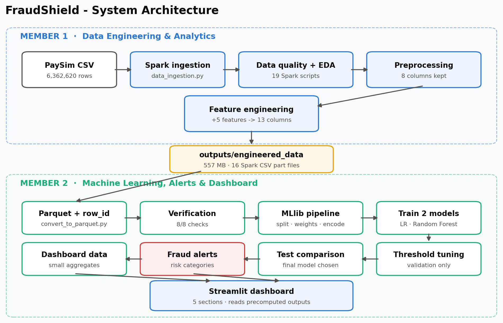
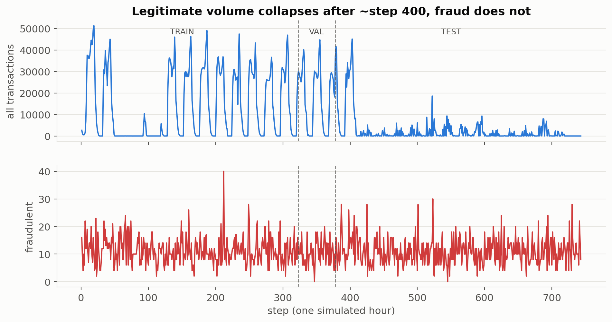
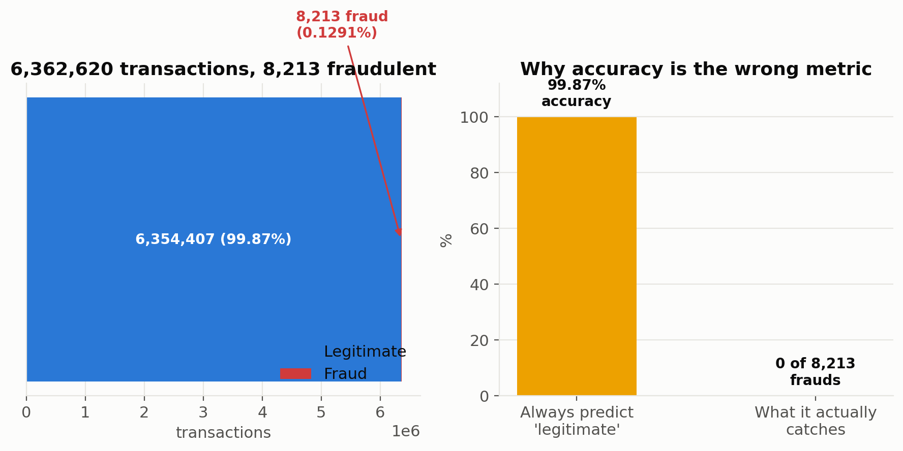
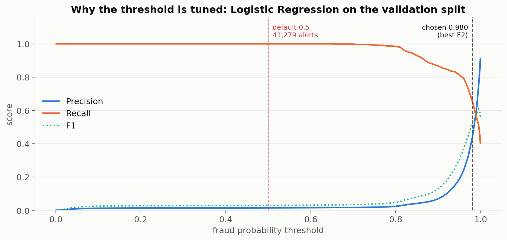
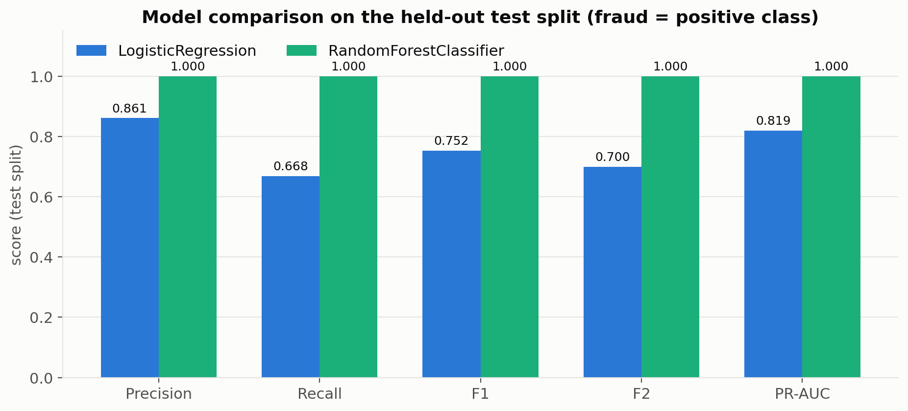
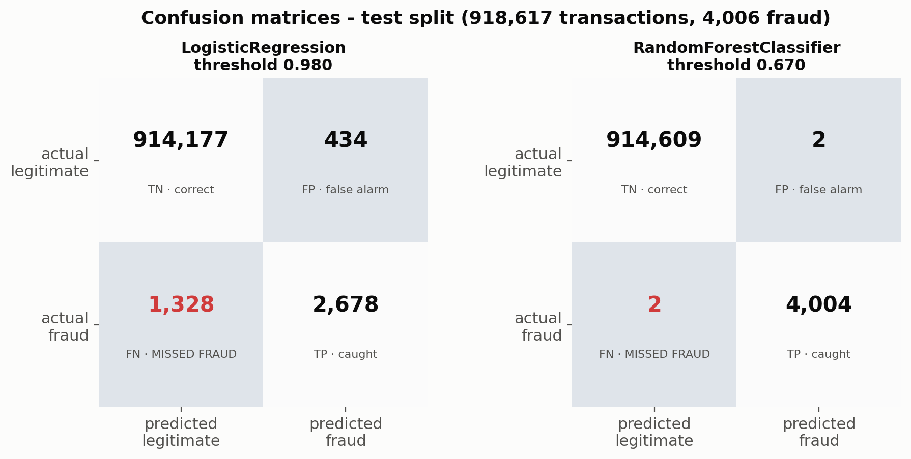
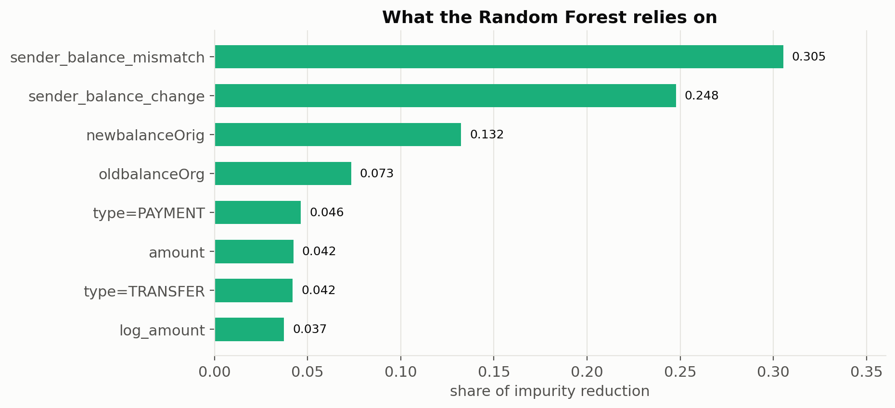
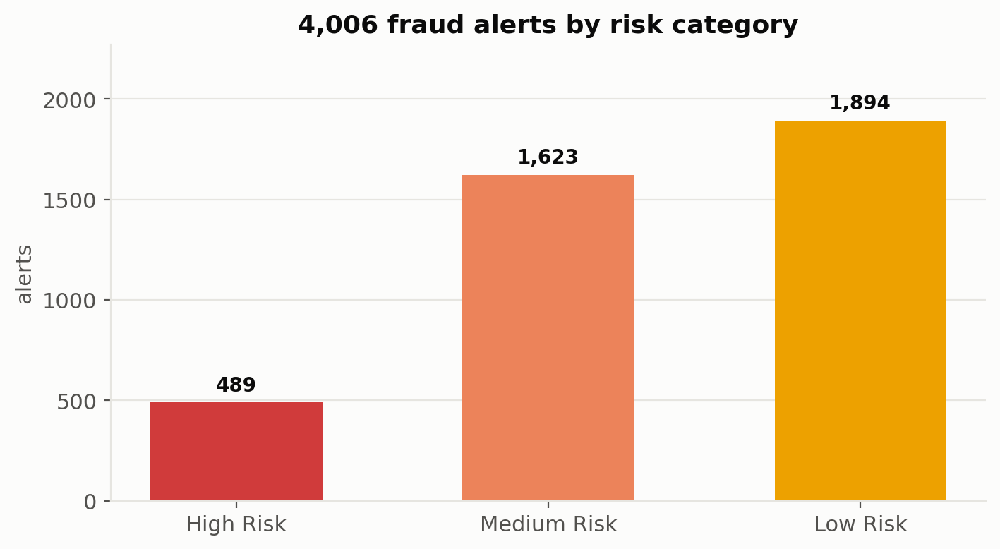

# FraudShield: Financial Fraud Detection Using Big Data Analytics

**B.Tech Mini Project Report — Artificial Intelligence and Data Science**

A two-member project. Member 1: Data Engineering and Analytics.
Member 2: Machine Learning, Fraud Alerting and Dashboard.

---

## Abstract

Financial fraud is rare, expensive, and buried in volumes of transaction data
too large for single-machine tools. FraudShield is an end-to-end fraud
detection system built on Apache Spark that processes the complete 6,362,620-row
PaySim transaction dataset, in which only 8,213 transactions (0.1291 %) are
fraudulent.

The system ingests and validates the data with PySpark, engineers five
behavioural features describing how money and account balances move, trains two
Spark MLlib classifiers (Logistic Regression and Random Forest) on a
chronological split, selects a fraud decision threshold from measured
validation evidence rather than the conventional 0.5, generates banded fraud
alerts, and presents the results through an interactive Streamlit dashboard.

On a held-out test window of 918,617 transactions containing 4,006 fraudulent
ones, the Random Forest achieved precision 0.9995, recall 0.9995 and PR-AUC
1.0000, against 0.8605 / 0.6685 / 0.8195 for Logistic Regression. Rather than
presenting the near-perfect score uncritically, we tested it: a hand-written
three-condition rule using no machine learning reaches precision 1.0000 and
recall 0.9730 on the same data, demonstrating that PaySim's fraud is
near-deterministic. We therefore report these figures as a property of the
simulator and not as a claim about real-world fraud detection.

**Keywords:** Big Data Analytics, Apache Spark, Spark MLlib, fraud detection,
class imbalance, threshold optimisation, PaySim.

---

## 1. Introduction

### 1.1 Background

Digital payment volumes have grown faster than the manual processes that once
reviewed them. A mid-sized payment provider can process millions of
transactions a day, of which a tiny fraction are fraudulent. Two properties
make automated detection difficult:

- **Volume.** Transaction logs quickly outgrow what one machine can hold in
  memory, so detection must run on a distributed engine.
- **Rarity.** Fraud is a fraction of a percent of traffic, so a model can
  appear highly accurate while catching nothing at all.

### 1.2 Problem statement

Given a large historical dataset of financial transactions, build a system that
processes the data at scale, learns to distinguish fraudulent from legitimate
transactions despite extreme class imbalance, chooses an operating point that
reflects the real cost difference between a missed fraud and a false alarm, and
presents the results so that a non-technical reviewer can act on them.

### 1.3 Objectives

1. Ingest and process a multi-million-row transaction dataset using Apache Spark.
2. Analyse transaction behaviour and identify patterns associated with fraud.
3. Engineer features that describe money and balance movement.
4. Train and compare two Spark MLlib classification models.
5. Evaluate using metrics appropriate to a rare positive class.
6. Select the fraud decision threshold from measured evidence.
7. Generate fraud alerts with interpretable risk categories.
8. Deliver an interactive dashboard driven by real pipeline outputs.

### 1.4 Scope and limitations of scope

The system performs **batch** detection: it scores a file of completed
transactions. It is not connected to a live payment switch and does not block
or reverse transactions. The dataset is synthetic (PaySim), because real
transaction data cannot be published. Two models are compared, by design, to
keep the project tractable for a two-member team.

---

## 2. Literature and background

**PaySim** (Lopez-Rojas, Elmir and Axelsson) is an agent-based simulator that
generates mobile-money transaction logs statistically resembling a real African
mobile money service, with injected fraudulent agents. It is the standard
public substitute for proprietary transaction data.

**The imbalanced-classification problem** is well documented: with a positive
class below 1 %, accuracy becomes uninformative, and the literature recommends
precision, recall, F-measures and precision-recall AUC instead. Common
remedies are resampling (SMOTE and variants) and cost-sensitive learning
(class weighting). We selected class weighting, for reasons given in §5.4.

**Apache Spark** provides distributed DataFrame processing and the MLlib
library, which implements classification algorithms that operate directly on
distributed data, avoiding the need to collect the dataset onto one machine.

---

## 3. System architecture



The system is a linear pipeline with a clean handover point between the two
members' work. Member 1's stages end by writing the engineered dataset to
`outputs/engineered_data`; Member 2's stages begin by reading it.

| Layer | Technology | Purpose |
|---|---|---|
| Processing | PySpark 4.3.0 (`local[*]`) | Distributed DataFrame operations over 6.36 M rows |
| Runtime | OpenJDK 17 | Spark runs on the JVM |
| Machine learning | Spark MLlib | Pipeline, encoders, classifiers, evaluators |
| Query | Spark SQL | Analytical aggregations |
| Storage | Parquet (snappy), CSV | Columnar typed persistence between stages |
| Presentation | Streamlit 1.42, Plotly 6.0 | Interactive dashboard |
| Serving helpers | pandas 2.2 | Rendering already-aggregated summaries only |

### 3.1 Design principle: heavy computation distributed, serving layer thin

Streamlit re-executes its script on every user interaction. If the dashboard
read the full dataset, each click would cost minutes and require a live Spark
session behind the web app. Instead, `src/prepare_dashboard_data.py` computes
every analytic once in Spark and writes small aggregate files (3.5 MB total);
the dashboard reads only those. This is the standard Big Data serving pattern
and is the single most important architectural decision in the project.

---

## 4. Data engineering (Member 1)

### 4.1 Dataset

| Property | Value |
|---|---|
| Source | PaySim synthetic mobile-money transactions |
| Transactions | 6,362,620 |
| Fraudulent | 8,213 (0.1291 %) |
| Legitimate | 6,354,407 (99.8709 %) |
| Time span | steps 1–743 (1 step = 1 simulated hour ≈ 31 days) |
| Columns after engineering | 13 |
| Missing values | 0 |

Transaction types: CASH_OUT 2,237,500 · PAYMENT 2,151,495 · CASH_IN 1,399,284 ·
TRANSFER 532,909 · DEBIT 41,432. **Fraud occurs only in TRANSFER (4,097) and
CASH_OUT (4,116).**

### 4.2 Pipeline

1. **Ingestion** — PaySim CSV loaded into a Spark DataFrame.
2. **Quality checks** — missing values, duplicates, negative amounts,
   categorical validity, numeric ranges.
3. **Exploratory analysis** — 19 Spark scripts: fraud distribution and
   percentage by type, amount distributions, fraud amount statistics, time
   analysis over `step`, sender and destination balance behaviour, balance
   mismatch analysis.
4. **Preprocessing** — retains `step`, `type`, `amount`, `oldbalanceOrg`,
   `newbalanceOrig`, `oldbalanceDest`, `newbalanceDest`, `isFraud`. Drops
   `nameOrig` and `nameDest` (unique account identifiers with no
   generalisable signal) and `isFlaggedFraud` (the output of the bank's own
   rule engine — using it would constitute target leakage).
5. **Feature engineering** — five features (§4.3).
6. **Validation** — schema, counts, nulls, fraud distribution.

### 4.3 Engineered features

| Feature | Definition | Intuition |
|---|---|---|
| `sender_balance_change` | `oldbalanceOrg − newbalanceOrig` | How much left the sender |
| `destination_balance_change` | `newbalanceDest − oldbalanceDest` | How much arrived |
| `log_amount` | `ln(1 + amount)` | Compresses a 0–10,000,000 range |
| `sender_balance_mismatch` | `1` if `\|oldbalanceOrg − amount − newbalanceOrig\| > 0.01` | Sender's books don't balance |
| `destination_balance_mismatch` | `1` if `\|oldbalanceDest + amount − newbalanceDest\| > 0.01` | Destination's books don't balance |

### 4.4 Independent verification by Member 2

Rather than trusting the handover notes, `src/verify_dataset.py` re-derives all
five features from the raw balance columns across all 6,362,620 rows and
compares them with the stored values.

| Check | Result |
|---|---|
| Row count = 6,362,620 | PASS |
| Fraud = 8,213 | PASS |
| Legitimate = 6,354,407 | PASS |
| Missing values = 0 | PASS |
| All five features match their formulas | PASS (**0 rows disagreed**) |
| Validation split has sufficient fraud | PASS |
| Test split has sufficient fraud | PASS |
| Splits are strictly time-ordered | PASS |

---

## 5. Machine learning methodology (Member 2)

### 5.1 Feature selection and leakage review

Model inputs: the eight numeric columns above plus one-hot encoded `type`.

Deliberate exclusions:

| Excluded | Reason |
|---|---|
| `isFraud` | It is the target |
| `isFlaggedFraud` | Output of another detector — target leakage |
| `nameOrig`, `nameDest` | Account identifiers; memorisable, not generalisable |
| `step` | **Used only to build the split.** In PaySim the fraud *share* rises in later steps because the simulator reduces legitimate activity; a model given `step` would learn this artefact |
| `row_id` | A display identifier we added; meaningless as a predictor |

All retained features are computed from values recorded at transaction time, so
none contains information from the future or from the label.

### 5.2 Chronological splitting

A random split would allow training on transactions occurring *after* those in
the test set — impossible in deployment and a source of inflated scores. The
split therefore follows `step`, with boundaries chosen by measuring the
cumulative row count:

| Split | Steps | Rows | Share | Fraud | Fraud rate |
|---|---|---:|---:|---:|---:|
| Train | 1–323 | 4,463,587 | 70.15 % | 3,643 | 0.0816 % |
| Validation | 324–378 | 980,416 | 15.41 % | 564 | 0.0575 % |
| Test | 379–743 | 918,617 | 14.44 % | 4,006 | 0.4361 % |



**A caveat we state openly.** Fraud is a far larger share of the test window
than of the training window, because PaySim's legitimate volume collapses after
approximately step 400 while fraud continues at a steady rate. Precision and
PR-AUC both depend on class prevalence, so test precision is flattered relative
to validation precision. Recall is prevalence-independent and is the fairer
cross-split comparison. We retained the chronological split because the
alternative — a random split — conceals a more serious methodological error
behind more attractive numbers.

### 5.3 Why accuracy is not used



A classifier that labels every transaction "legitimate" achieves 99.87 %
accuracy on this dataset and detects zero fraud. All reported metrics are
therefore computed with **fraud as the positive class**:

| Metric | Formula | Meaning |
|---|---|---|
| Precision | TP / (TP + FP) | Share of alerts that were genuine fraud |
| Recall | TP / (TP + FN) | Share of all fraud that was caught |
| F1 | 2PR / (P + R) | Harmonic mean; high only when both are |
| F2 | 5PR / (4P + R) | Recall weighted twice as heavily |
| PR-AUC | area under the PR curve | Threshold-free summary for a rare class |
| ROC-AUC | — | Secondary; generous on imbalanced data |

### 5.4 Class imbalance handling

Each training row receives weight `total / (2 × class_count)`, giving fraud a
weight of 612.63 and legitimate 0.5004, so the two classes contribute equally
to the loss. Both MLlib classifiers accept a `weightCol`, so no data is
duplicated or discarded.

**Rejected alternatives and why:**

- *SMOTE* — would fabricate millions of synthetic financial records, risking
  impossible balance arithmetic, and has no mature distributed implementation.
- *Undersampling the majority* — would discard the data that defines normal
  behaviour; we have the compute to use all of it.
- *Any resampling before splitting* — would leak copies of a transaction across
  the train/test boundary.

Class weighting has one visible consequence: predicted probabilities are pushed
upwards, which is precisely why the default 0.5 threshold is unsuitable (§5.6).

### 5.5 Models

Both are Spark MLlib `Pipeline`s containing the feature transformations and the
classifier, so training and scoring apply identical transformations.

```
type ──StringIndexer──▶ type_index ──OneHotEncoder──▶ type_ohe ──┐
                                                                 ├─▶ VectorAssembler ─▶ features ─▶ classifier
10 numeric columns ─────────────────────────────────────────────┘
                              (+ StandardScaler, Logistic Regression only)
```

**Logistic Regression.** A linear model; fast and directly interpretable
through its coefficients. Features are standardised because raw amounts reach
10 million while `log_amount` stays below 17. `regParam` was tuned over
{0.0, 0.001, 0.01, 0.1} on validation PR-AUC; 0.0 was selected.

**Random Forest.** An ensemble of decision trees, each grown on a subsample of
rows and a random subset of features. It captures *combinations* of conditions
that a linear model cannot express. No scaling is applied, since a tree
compares one feature against a threshold at a time. The grid {100 trees} ×
{depth 8, 14} was evaluated on validation PR-AUC; depth 14 was selected.

**`CrossValidator` was deliberately not used:** k-fold cross-validation
shuffles rows across folds, mixing future transactions into training and
defeating the chronological split. A plain loop scored on the chronological
validation window is the correct equivalent.

### 5.6 Threshold optimisation



Approximately 100 candidate thresholds are evaluated on the validation split in
a **single Spark pass** (all thresholds expressed as parallel aggregate
expressions). Four policies are measured:

| Policy | Meaning |
|---|---|
| `best_f1` | Treats a missed fraud and a false alarm as equally costly |
| `best_f2` | Weights recall twice as heavily as precision |
| `recall_at_least_0.80` | Most precise threshold reaching 80 % recall |
| `precision_at_least_0.50` | Highest-recall threshold reaching 50 % precision |

**FraudShield adopts `best_f2`.** An undetected fraudulent transfer is a direct
financial loss; a false alarm costs an analyst a few minutes of review. F2
favours recall accordingly, while still penalising a threshold that floods the
team — unlike "maximise recall", which is trivially satisfied at a threshold of
zero where every transaction is an alert.

**Model selection also occurs here, on validation only.** The test split is
read exactly once afterwards, by `src/model_comparison.py`.

---

## 6. Results

### 6.1 Model comparison (test split: 918,617 transactions, 4,006 fraudulent)



| Model | Threshold | Precision | Recall | F1 | F2 | PR-AUC | ROC-AUC | TP | FP | FN |
|---|---:|---:|---:|---:|---:|---:|---:|---:|---:|---:|
| Logistic Regression | 0.980 | 0.8605 | 0.6685 | 0.7525 | 0.6997 | 0.8195 | 0.9939 | 2,678 | 434 | 1,328 |
| **Random Forest (final)** | 0.670 | 0.9995 | 0.9995 | 0.9995 | 0.9995 | 1.0000 | 1.0000 | 4,004 | 2 | 2 |

The final model was selected on **validation** PR-AUC (0.9998 vs 0.4205) before
the test split was read.



### 6.2 The value of threshold tuning

| Model | Threshold | Precision | Recall | Alerts raised |
|---|---:|---:|---:|---:|
| Logistic Regression | 0.500 (default) | 0.0964 | 0.9930 | 41,279 |
| Logistic Regression | **0.980 (tuned)** | 0.8605 | 0.6685 | 3,112 |
| Random Forest | 0.500 (default) | 0.9970 | 0.9995 | 4,016 |
| Random Forest | **0.670 (tuned)** | 0.9995 | 0.9995 | 4,006 |

For Logistic Regression, tuning reduced the alert volume by 92 % while raising
precision from 9.6 % to 86.1 %. This single step is the difference between an
unusable model and a deployable one.

### 6.3 Validation versus test

| Model | Split | Precision | Recall | F1 | PR-AUC |
|---|---|---:|---:|---:|---:|
| Logistic Regression | validation | 0.4349 | 0.6578 | 0.5236 | 0.4205 |
| Logistic Regression | test | 0.8605 | 0.6685 | 0.7525 | 0.8195 |
| Random Forest | validation | 0.9947 | 1.0000 | 0.9973 | 0.9998 |
| Random Forest | test | 0.9995 | 0.9995 | 0.9995 | 1.0000 |

Test precision exceeds validation precision for both models. This is primarily
a prevalence effect (0.4361 % fraud in test against 0.0575 % in validation),
not genuine improvement.

### 6.4 Feature ablation: do the balance-mismatch features earn their place?

Member 1's handover notes asked for this check, observing that balance
inconsistency alone appeared to be a weak indicator. The same model was trained
twice on the same split, changing only whether the two flags were included.

| Model | PR-AUC with flags | PR-AUC without | Change |
|---|---:|---:|---:|
| Logistic Regression | 0.420510 | 0.292323 | **+43.85 %** |
| Random Forest | 0.999861 | 0.761223 | **+31.35 %** |

**Verdict: keep them.** This does not contradict Member 1's finding. Balance
inconsistency *on its own* genuinely is a weak indicator — the flags fire on
79.8 % and 65.8 % of all rows. What the ablation demonstrates is that they are
valuable *in combination* with the other features: they tell the model which
transactions obey the expected balance arithmetic, and that context changes how
the balance columns should be read. A feature can be uninformative univariately
and still carry substantial conditional information.

### 6.5 Sanity check: is the dataset near-deterministic?

A test F1 of 0.9995 normally indicates leakage, so we tested whether PaySim's
fraud is separable with no machine learning at all. `src/rule_baseline.py`
evaluates one hand-written rule:

```
type ∈ {TRANSFER, CASH_OUT}  AND  amount == oldbalanceOrg  AND  newbalanceOrig == 0
```

In words: *someone emptied this account in a single move.*

| Split | Rows | Fraud | Rule matched | Precision | Recall | F1 |
|---|---:|---:|---:|---:|---:|---:|
| Validation | 980,416 | 564 | 559 | 1.0000 | 0.9911 | 0.9955 |
| Test | 918,617 | 4,006 | 3,898 | 1.0000 | 0.9730 | 0.9863 |

Three conclusions follow:

1. **The Random Forest is not performing a subtle feat.** PaySim's fraud agents
   drain the victim's balance exactly, leaving an almost perfect signature. The
   forest rediscovers that conjunction.
2. **This explains the gap between the two models.** The rule is a conjunction
   of three conditions. A decision tree expresses it in three splits; logistic
   regression sums weighted features and cannot represent an AND at all. The
   gap is a structural limitation of the model class, not a tuning deficiency.
3. **It is not target leakage.** The rule uses only fields recorded at
   transaction time. The separability is a property of the simulator — which is
   why these scores describe PaySim and must not be read as a claim about
   detecting real fraud.

### 6.6 What the models learned



The Random Forest relies most heavily on `sender_balance_change`,
`sender_balance_mismatch`, `newbalanceOrig` and `oldbalanceOrg` — consistent
with the account-draining signature identified above. For Logistic Regression,
the largest positive coefficients belong to `sender_balance_change` and the
TRANSFER/CASH_OUT indicators, and the largest negative coefficient to
`sender_balance_mismatch`.

### 6.7 Fraud alerts



Scoring the test split with the final model produced **4,006 alerts** (0.4361 %
of transactions) covering 6,322,314,930.80 in transaction value, of which 4,004
were genuine fraud and 2 were false alarms.

| Risk category | Alerts | Total amount |
|---|---:|---:|
| High Risk | 489 | 55,803,288.61 |
| Medium Risk | 1,623 | 4,424,311,323.16 |
| Low Risk | 1,894 | 1,842,200,319.03 |

Band boundaries are derived from measured validation data. Where a model
already exceeds 90 % precision at its operating threshold — as the Random
Forest does — precision-based bands collapse onto a single value and every
alert would be labelled High Risk. The implementation detects this and falls
back to percentiles of the flagged score distribution, recording the fallback
in the saved policy file so it is visible in both the dashboard and this
report.

---

## 7. Dashboard

Five sections, all driven by real pipeline outputs:

| Section | Contents |
|---|---|
| Overview | Headline counts, fraud value, class balance, split table, verification results |
| Transaction analytics | Volume and fraud rate by type, amount bands, fraud over time, hour-of-day pattern, balance behaviour |
| Model performance | Comparison table, metric chart, confusion matrices, threshold curve, candidate policies, importances and coefficients |
| Fraud detection | Alert table with filters (type, risk, amount, probability) and the risk breakdown |
| Downloads | Every result file as CSV/JSON |

No value is hard-coded; a missing file produces a message naming the script
that generates it. Cache keys include each file's modification time, so
re-running a Spark stage refreshes the dashboard automatically.

---

## 8. Testing

See **[TEST_REPORT.md](TEST_REPORT.md)** for the full evidence. Summary: 16
end-to-end integration checks, all passing, covering dataset integrity, split
ordering, pipeline execution, model save/reload fidelity, metric arithmetic
verified against hand-worked values, threshold policy consistency, alert
correctness and dashboard readiness.

---

## 9. Conclusion

FraudShield demonstrates a complete Big Data analytics workflow: distributed
ingestion and validation of 6.36 million transactions, Spark SQL analytics,
MLlib feature pipelines, two trained classifiers, evidence-based threshold
selection, banded alert generation and an interactive dashboard — with Spark as
the processing engine throughout.

The most valuable outcomes are methodological rather than numerical:

- **Threshold selection matters more than model choice** for the linear model:
  tuning took Logistic Regression from 41,279 alerts at 9.6 % precision to
  3,112 at 86.1 %.
- **Model class determines what is learnable.** The fraud signature is a
  conjunction; trees represent it, linear models cannot.
- **A result that looks too good should be tested, not celebrated.** The rule
  baseline established that PaySim's fraud is near-deterministic, which bounds
  what we can honestly claim.

---

## 10. Limitations

- **Synthetic data.** PaySim's fraud pattern is consistent and far more
  learnable than real fraud. These results do not transfer to production.
- **Prevalence shift across time** inflates test precision and PR-AUC relative
  to validation.
- **Batch, not streaming.** No live feed, no blocking, no case management.
- **No account-history features.** Each transaction is scored independently;
  real systems use per-account velocity and behavioural history.
- **Single machine.** Spark local mode on 8 GB RAM constrained the
  hyperparameter grid to two Random Forest configurations and forced cached
  feature vectors to spill to disk.
- **No model monitoring.** Drift detection and scheduled retraining are not
  implemented.

---

## 11. Future enhancements

1. Spark Structured Streaming for near-real-time scoring.
2. Per-account velocity features over rolling windows.
3. Gradient-boosted trees as a third model, with probability calibration.
4. Cost-based threshold selection using explicit costs per missed fraud and per
   false alarm.
5. Analyst feedback captured from the alert queue and fed into retraining.
6. Per-alert explainability showing feature contributions beside each flagged
   transaction.
7. Validation against a second, less deterministic dataset to test whether the
   method generalises beyond PaySim.

---

## 12. Member contributions

**Member 1 — Data Engineering and Analytics.** Environment setup; Spark
ingestion of PaySim; data quality checks (missing values, duplicates, negative
values, categorical and numerical validity); 19 exploratory analysis scripts;
preprocessing and column selection; the five engineered features;
engineered-dataset validation.

**Member 2 — Machine Learning, Alerts and Dashboard.** Independent verification
of the engineered dataset; Parquet conversion; MLlib feature pipeline;
chronological splitting; class-weight imbalance handling; Logistic Regression
and Random Forest training with validation-based hyperparameter selection; the
evaluation module; threshold optimisation and the F2 operating-point policy;
the balance-mismatch ablation; the deterministic-rule sanity check; final test
comparison and model selection; fraud alert generation with validation-derived
risk bands; the Streamlit dashboard; the 16-check integration suite.

**Joint.** System architecture, integration, testing strategy, this report, the
presentation and the demonstration.

---

## 13. Reproducibility

All results in this report are produced by the code in this repository. The
figures and the results tables are generated from the saved output files by
`src/generate_figures.py` and `src/generate_report.py`, so the documentation
cannot drift from the measured numbers.

```bash
source env.sh && ./run_pipeline.sh
```

Setup, execution and troubleshooting: **[SETUP.md](SETUP.md)**.
Full measured results: **[RESULTS.md](RESULTS.md)**.
Design reasoning: **[METHODOLOGY.md](METHODOLOGY.md)**.

---

## References

1. E. A. Lopez-Rojas, A. Elmir and S. Axelsson. *PaySim: A Financial Mobile
   Money Simulator for Fraud Detection.* 28th European Modeling and Simulation
   Symposium, 2016.
2. Apache Spark documentation — MLlib Guide. https://spark.apache.org/docs/latest/ml-guide.html
3. T. Saito and M. Rehmsmeier. *The Precision-Recall Plot Is More Informative
   than the ROC Plot When Evaluating Binary Classifiers on Imbalanced Datasets.*
   PLoS ONE, 2015.
4. H. He and E. A. Garcia. *Learning from Imbalanced Data.* IEEE Transactions on
   Knowledge and Data Engineering, 2009.
5. L. Breiman. *Random Forests.* Machine Learning, 45(1), 2001.
